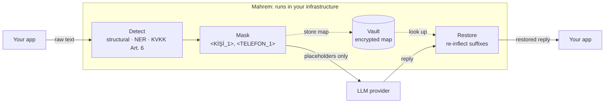

<div align="center">

# Mahrem

**A privacy layer for LLMs, built for Turkish.**

Mahrem masks personal data in Turkish text before it reaches an LLM,<br/>
then puts the real values back into the response with correct Turkish grammar.

[](https://github.com/thebozturk/mahrem/actions/workflows/ci.yml)
[](LICENSE)


[How it works](#how-it-works) · [Status](#status) · [Roadmap](ROADMAP.md) · [Contributing](#contributing)

</div>

---

```text
Input        Merhaba, ben Ayşe Demir. Kızım Elif'in süt alerjisi var, 0500 000 00 00'dan ulaşabilirsiniz.

To the LLM   Merhaba, ben <KİŞİ_1>. Kızım <KİŞİ_2>'in <SAĞLIK_1> var, <TELEFON_1>'dan ulaşabilirsiniz.

LLM reply    <KİŞİ_2>'ın alerjisi için <KİŞİ_1>'e dönüş yapılmalı.

Restored     Elif'in alerjisi için Ayşe Demir'e dönüş yapılmalı.
```

The LLM never sees the name, the child's name, the health condition or the phone number. The mapping between placeholders and real values stays in your infrastructure. Note the last line: the LLM wrote `<KİŞİ_2>'ın`, and a plain find-and-replace would have produced *Elif'ın*. Mahrem re-inflects the suffix for the real value and returns *Elif'in*.

> [!WARNING]
> **Mahrem is in its preparation phase and is not usable yet.** Today the core contains checksum validators and Turkish case mapping. Masking, restoration and the gateway are being built gate by gate; see [Status](#status) and the [roadmap](ROADMAP.md). Watch the repository to follow along.

## Why Mahrem?

Teams send more and more customer messages, e-mails, order notes and forms to LLMs. In Türkiye these texts carry names, phone numbers, addresses, national ID numbers and IBANs, and sometimes health or religious information. Open-source PII tools are English-first, and Turkish breaks them in specific ways:

| Problem | Example | What Mahrem does |
| --- | --- | --- |
| Turkish identifiers | TCKN, YKN, VKN, `TR` IBANs | Regex **plus checksum validation**, so random 11-digit numbers are not flagged |
| Agglutination | *Ahmet'in*, *Ayşe'ye*, *Ankara'dan* | Keeps the suffix outside the mask and **re-inflects it** on the way back |
| Names that are also words | *Umut* (hope), *Deniz* (sea), *Bahar* (spring) | Context-aware Turkish NER plus name dictionaries |
| Messy real-world text | *Ayse Yilmaz*, `0 5 3 2 - 1 2 3`, IBANs split across lines | Normalization before detection; dotted/dotless `İ`/`ı` handled explicitly |
| Special-category data | Health, religion, ethnic origin | A context layer for [KVKK](https://kvkk.gov.tr/Icerik/6649/Personal-Data-Protection-Law) Article 6, Türkiye's rules on sensitive data |

## How it works

*This section describes the design. See [Status](#status) for what is implemented today.*



**Three detection layers run in a single Rust core:**

1. **Structural recognizers:** patterns, checksums and context words for TCKN, VKN, IBAN, card numbers, phone numbers, e-mail addresses and more. These have to be right every time, so they are deterministic and validated.
2. **Turkish NER:** names, addresses, organizations and children's data, served with ONNX Runtime on CPU. No Python or GPU needed at inference time.
3. **KVKK Article 6 context layer:** a sentence-level classifier for special categories such as health, religion and ethnic origin.

The Python library, the LLM gateway and the benchmark CLI all run the **same Rust engine**, and a shared conformance suite keeps them in agreement.

### Placeholders that LLMs understand

Mahrem replaces values with typed, numbered placeholders like `<KİŞİ_1>` rather than random IDs. The model still knows it is talking about a person, a phone number or an address, so answer quality holds up. The same value gets the same placeholder throughout a conversation.

Restoration is where Turkish gets hard, and where Mahrem spends its effort:

| LLM output | Real value | Naive replace | Mahrem | Rule |
| --- | --- | --- | --- | --- |
| `<KİŞİ_1>'e` | Ayşe | Ayşe'e | **Ayşe'ye** | buffer consonant |
| `<KİŞİ_1>'a` | Mehmet | Mehmet'a | **Mehmet'e** | vowel harmony |
| `<KİŞİ_1>'de` | Mehmet | Mehmet'de | **Mehmet'te** | consonant assimilation |
| `<KİŞİ_1>'nin` | Ahmet | Ahmet'nin | **Ahmet'in** | buffer consonant |
| `<TELEFON_1>'den` | … 45 40 | …40'den | **…40'tan** | numbers are read aloud (*kırk*) |
| `<KİŞİ_1>'in` | Mike | Mike'in | **Mike'ın** | foreign names follow pronunciation (*Mayk*) |

Placeholders that the LLM translates (`<PERSON_1>`), reformats (`[KİŞİ 1]`) or splits across streaming chunks are still resolved. Placeholders it invents are never filled in. Placeholder-looking text in the input is escaped, and values are only restored for the party that supplied them, so nobody can make the LLM print someone else's data from a RAG document.

## Planned usage

> [!NOTE]
> The APIs below are the target design for v0.5 and v1.0. They do not exist yet.

**Python library:** add masking to an existing flow in a few lines.

```python
import mahrem

s = mahrem.session()  # default KVKK policy, no config needed
masked = s.mask("Ben Ayşe Demir, TCKN 10000000146")
reply = llm(masked.text)  # the LLM only sees placeholders
print(s.unmask(reply))  # real values, correct suffixes
```

**LLM gateway:** protect every outgoing LLM call from one place, in any language. The only change in your application is the base URL.

```sh
docker run -p 8080:8080 -e MAHREM_UPSTREAM=https://api.openai.com ghcr.io/thebozturk/mahrem-gateway
```

```python
from openai import OpenAI

client = OpenAI(base_url="http://localhost:8080/v1")  # the only change
```

Streaming, multi-turn conversations, tool calls and a LiteLLM guardrail adapter are part of the v1.0 scope.

## Status

Mahrem moves forward by **measurement gates, not dates**: a phase starts only when the previous gate is met, and every gate's results are published.

| Phase | Focus | Exit gate |
| --- | --- | --- |
| **Preparation** *(current)* | Gold set, labeling workflow, batch harness, evaluating existing models | Model decision |
| v0.1 | Structural recognizers, Python package, benchmark CLI | Structural recall ≥ 99% |
| v0.5 | Turkish NER, masking operators, suffix-aware restoration | Leak-free documents ≥ 80%, restoration ≥ 99% |
| v1.0 | Gateway, LiteLLM adapter, vault access control, KVKK Art. 6 layer | Leak-free documents ≥ 90% (≥ 99% for high-risk data), real-data evaluation, legal review |

The full plan, including candidates after v1.0, is in [ROADMAP.md](ROADMAP.md).

### What works today

Checksum validators for Turkish identifiers and Turkish-aware case mapping, in Rust and Python:

```rust
use mahrem_core::{is_valid_iban_tr, is_valid_tckn, to_lowercase_tr};

assert!(is_valid_tckn("10000000146"));
assert!(is_valid_iban_tr("TR330006100519786457841326"));
assert_eq!(to_lowercase_tr("İSTANBUL ILGAZ"), "istanbul ılgaz"); // not "i̇stanbul ilgaz"
```

The Python package is not on PyPI yet. To try it from source:

```sh
git clone https://github.com/thebozturk/mahrem && cd mahrem
uv sync
uv run python -c "import mahrem; print(mahrem.is_valid_tckn('10000000146'))"
```

## Measured in the open

The main metric is the **leak-free document rate**: the share of documents in which *no* personal data slipped through. Entity-level recall hides the real risk. At 90% recall, a message with five pieces of personal data leaks at least one of them about 41% of the time (1 − 0.9⁵).

- **Gold set:** hand-written and synthetic Turkish texts with human-verified labels, including documents with no personal data so that false alarms are measured too. The open part is published under CC BY 4.0.
- **Closed part:** a held-out split with the same distribution, never published so it cannot leak into training data. Its SHA-256 digest is published with every release, and it is rotated into the open set at each major version.
- **Hard cases:** text without Turkish characters, names that are words, spaced and split numbers, numbers written out in words. Open: [`datasets/hard-cases`](datasets/README.md).
- **Synthetic only:** the project never collects real personal data.

Every release report shows results on both the open and the closed part.

## Supported data

| Group | Examples | Detection | Version |
| --- | --- | --- | --- |
| Identity and tax | TCKN, YKN, VKN | Pattern + checksum + context | v0.1 |
| Financial | IBAN (`TR`, 26 characters), card numbers | IBAN mod-97, Luhn | v0.1 |
| Contact | Mobile and landline numbers, e-mail | Pattern + normalization | v0.1 |
| Other IDs | Passport, driver's license, SGK, MERSİS, customer and account numbers | Pattern + checksum + context | v0.5 |
| Vehicles, devices, dates | License plate, serial number, IP, MAC, date of birth | Pattern + validation + context | v0.5 |
| Secrets | API keys, JWTs, private keys, passwords | Pattern + entropy | v0.5 |
| People | Names, honorifics (*Ayşe Hanım*) | NER + name dictionary | v0.5 |
| Addresses | Neighborhood, street, district, province, postal code | NER + gazetteer | v0.5 |
| Organizations and children | Employer, school, hospital; a child's name and age | NER + context (*oğlum*, *kızım*) | v0.5 |
| KVKK Art. 6 | Health, religion, ethnic origin, political opinion, union membership, criminal records, biometric and genetic data, sex life | Sentence classifier | v1.0 |

Each category's placeholder name, threshold and operator (placeholder, partial mask, keyed hash or realistic Turkish fake data) is configurable by policy.

## Design principles

- **Your infrastructure only.** No hosted service, no telemetry. Runs offline on CPU; models are downloaded explicitly with checksums.
- **Fail closed.** If masking fails, the request does not reach the LLM.
- **No raw values in logs.** Logs, metrics and audit records carry categories and counts, never the data.
- **Separate permission to unmask.** The vault is encrypted, and reversing placeholders requires its own authorization.
- **Explainable.** Every detection can be traced to its layer, rule or model, score and context.
- **Minimal integration.** One line for the gateway, at most three commands from install to first masked text.

## What Mahrem is not

- **Not an anonymization tool.** Reversible operators (placeholders, fake data) are *pseudonymization*: the data remains personal data for whoever holds the mapping.
- **Not a compliance guarantee.** Mahrem is a technical safeguard. It does not make you KVKK compliant on its own.
- **Not a prompt-injection or hallucination filter.** Those are out of scope.

## Repository layout

| Path | Purpose | State |
| --- | --- | --- |
| `crates/mahrem-core` | Detection, masking and restoration engine | Validators, Turkish case mapping, labels, fake value generators |
| `crates/mahrem-py` | Python bindings (PyO3, abi3 wheels) | Working |
| `crates/mahrem-dataset` | Gold set and prediction file format, validator ([format](docs/gold-set/README.md)) | Working |
| `crates/mahrem-ner` | Turkish NER on ONNX Runtime | Placeholder |
| `crates/mahrem-vault` | Encrypted placeholder ↔ value mapping | Placeholder |
| `crates/mahrem-llm` | OpenAI-compatible client shared by the gateway and data generation; local endpoints only by default | Working |
| `crates/mahrem-harness` | Resumable batch runner for data generation and evaluation | Working |
| `crates/mahrem-tools` | Tool definitions shared by agents and the MCP server | Placeholder |
| `crates/mahrem-gateway` | LLM gateway | Placeholder |
| `crates/mahrem-bench` | Benchmark CLI | Placeholder |
| `conformance/` | Test cases shared by Rust and Python | 23 cases |
| `datasets/` | Open datasets (CC BY 4.0) | Hard cases: 82 documents |

## Development

You need Rust (the toolchain is pinned in `rust-toolchain.toml`) and [uv](https://docs.astral.sh/uv/).

```sh
make check      # rustfmt, clippy, tests
make py-test    # build the Python package, pytest, ruff
make deny       # licenses, sources and advisories (cargo-deny)
```

## Contributing

Contributions are welcome, especially Turkish edge cases: unusual spellings, ambiguous names and tricky suffixes. Please read [CONTRIBUTING.md](CONTRIBUTING.md) first. The short version:

- **No real personal data**, anywhere: tests, examples, issues or pull requests. Use synthetic values.
- Dependencies must use permissive licenses (MIT, Apache-2.0, BSD, ISC, Zlib, Unicode-3.0) and come from crates.io.
- No `unsafe` Rust outside the PyO3 bindings.
- Sign off your commits (`git commit -s`, [DCO](https://developercertificate.org/)).

To report a vulnerability, use [private vulnerability reporting](SECURITY.md) instead of a public issue.

## License

Code is licensed under [Apache-2.0](LICENSE). Datasets are published under [CC BY 4.0](datasets/LICENSE).

---

<sub>*Mahrem* is Turkish for "private, confidential": what stays within the inner circle.</sub>
