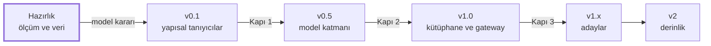

# Yol haritası

Mahrem takvimle değil, ölçüm kapılarıyla ilerler. Bir sonraki aşamaya, önceki kapının ölçütleri sağlandığında geçilir. Bu yüzden bu belgede tarih yoktur. Her kapının sonuçları sürüm raporunda açıkça yayınlanır.

> Şu an: **Hazırlık** aşamasındayız.

## Nasıl ölçüyoruz?

- **Ana metrik sızıntısız belge oranıdır:** hiçbir kişisel verisi açıkta kalmamış belgelerin oranı. Varlık düzeyinde %90 recall, 5 kişisel veri içeren mesajların yaklaşık %41'inde en az bir sızıntı demektir (1 − 0,9⁵). Bu yüzden kapılar kategori recall'una değil, bu orana bağlıdır.
- **Altın setin açık ve kapalı bölümü vardır.** Açık bölüm CC BY 4.0 ile yayınlanır. Kapalı bölüm modellerin eğitim verisine karışmasın diye yayınlanmaz; her sürümde SHA-256 özeti yayınlanır, her ana sürümde açılıp yenilenir.
- **Her sürüm raporunda iki sayı yer alır:** açık bölüm ve kapalı bölüm sonucu.

## Hazırlık: ölçüm ve veri

Durum: **sürüyor**

- [x] Repo iskeleti, CI ve tedarik zinciri denetimi (cargo-deny, cargo-audit, SHA'ya sabitlenmiş Action'lar)
- [x] Doğrulayıcılar: TCKN/YKN, VKN, IBAN (mod 97), kart (Luhn); ortak test seti
- [ ] Altın set v0: açık ve kapalı bölüm
- [x] Etiketleme yönergesi ve zor örnekler seti
- [x] Rust harness ve LLM istemcisi (`mahrem-harness`, `mahrem-llm`)
- [ ] Etiketleme iş akışı: tanıyıcılar, NER ve sözlükler her belgede çalışır; yerel LLM yalnızca uyuşmazlıkta karar verir; etiketi insan onaylar
- [ ] Aday modellerin altın sette ölçülmesi

**Çıkış kapısı: model kararı.** Ölçüme göre üç yoldan biri seçilir: hazır bir model, ince ayar ya da yeni bir model.

## v0.1: yapısal tanıyıcılar

v0.1 bilerek dar tutulur. Bu kısım kesin çalışır ve tek başına işe yarar.

- [ ] Serbest metinde TCKN/YKN, VKN, IBAN, kart, telefon ve e-posta tespiti
- [ ] Düzensiz yazımın normalleştirilmesi: boşluklu, tireli ve bölünmüş numaralar
- [ ] Türkçe harf dönüşümü (`İ` → `i`, `I` → `ı`)
- [ ] Rust çekirdeği ve Python paketi (`pip install mahrem`)
- [ ] Benchmark CLI ve ilk açık rapor

**Kapı 1:** yapısal recall ≥ %99; sızıntı baz çizgisi ölçülüp yayınlanır.

## v0.5: model katmanı

- [ ] Ad, adres, kurum ve çocuk verisi (Türkçe NER, ONNX)
- [ ] Operatörler: etiket (`<KİŞİ_1>`), kısmi maske, anahtarlı hash, Türkçe sahte veri
- [ ] Tutarlı numaralandırma: aynı değer oturum boyunca aynı etiketi alır
- [ ] Politika ön ayarları ve CLI
- [ ] Türkçe ek uyumu ve geri yerleştirme: "<KİŞİ_1>'e" → "Ayşe'ye"; yabancı adlarda okunuşa göre ek ("Mike'ın")

**Kapı 2:** sızıntısız belge ≥ %80; geri yerleştirme ≥ %99.

## v1.0: kütüphane ve gateway

- [ ] OpenAI uyumlu Rust gateway, streaming dahil; uygulamada yalnızca `base_url` değişir
- [ ] LiteLLM guardrail adaptörü
- [ ] Çok turlu sohbet, tool call ve ek dosya politikası
- [ ] Vault erişim kontrolü: geri çevirme ayrı yetki ister
- [ ] KVKK m.6 bağlam katmanı (sağlık, din, etnik köken gibi özel nitelikli veri)
- [ ] Playground ve OpenAI istemci sarmalayıcısı (`mahrem.wrap(client)`)
- [ ] Yanıt kalitesi ölçümü: maskeli ve maskesiz yanıt farkı

**Kapı 3:**

- sızıntısız belge ≥ %90, yüksek riskli kategorilerde (TCKN/YKN, VKN, IBAN, kart, KVKK m.6) ≥ %99;
- gerçek kurumsal veri üzerinde ölçüm (veri kurum dışına çıkmaz, yalnızca kategori bazında sonuç yayınlanır);
- takma adlandırılmış verinin hukuki durumu için hukukçu görüşü.

## v1.x: adaylar ve entegrasyon

Bu aşamadaki maddeler adaydır. Sıralarını v1.0 ölçümü ve kullanıcı ihtiyacı belirler; kapılar v1.0 sonrasında tanımlanır.

- RAG bileşenleri (LangChain, LlamaIndex) ve kalıcı etiket kapsamı: aynı kişi bir bilgi tabanında oturumlar arası aynı etiketi alır
- Genelleştirme operatörleri ve etiket ipuçları (`<KİŞİ_1 cinsiyet=kadın>`, varsayılan kapalı)
- Red-team hattı ve açık Türkçe PII leaderboard
- Kod ve PR tarayıcı (GitHub Action)
- Tarayıcı eklentisi ve TypeScript paketi (WebAssembly)
- Log hattı: Fluent Bit, Vector, Kafka
- MCP sunucusu, toplu işleme (CSV, JSONL, Parquet), Helm chart
- Ajan çalışma zamanı önizlemesi (`mahrem-agents`): maskelenmemiş verinin dış modele gitmesini politika olarak engeller

## v2: derinlik

- Ajan çalışma zamanının kararlı API'si: dayanıklı yürütme, denetim ağacı, araç yalıtımı (WebAssembly, sandbox)
- DOCX, PDF ve görsel (OCR)
- Türk dilleri: Azerice, Kazakça, Özbekçe

Kurumsal özellikler (Mahrem Enterprise) bu yol haritasında yer almaz.

## Mahrem ne değildir?

- **Anonimleştirme aracı değildir.** Geri çevrilebilen operatörler (etiket, sahte veri) hukuken takma adlandırmadır; veri, eşleme anahtarını tutan kurum için kişisel veri olmaya devam eder.
- **Hukuki uyum garantisi vermez.** Mahrem bir teknik önlemdir; KVKK uyumunu tek başına sağlamaz.
- **Barındırılan bir servis değildir.** Tamamen kurum içinde, internet erişimi olmadan çalışır.
- Prompt injection ve halüsinasyon koruması kapsam dışıdır.

## Katkı

Bir maddeye katkı vermek ya da v1.x adaylarının sırası hakkında görüş bildirmek için issue açın ve ilgili aşamayı belirtin. Kurallar için [CONTRIBUTING.md](CONTRIBUTING.md).

---

## English

Mahrem moves forward by measurement gates, not by dates: each phase starts only when the previous gate's criteria are met. The main metric is the leak-free document rate, measured on a gold set with an open part (CC BY 4.0) and a closed part whose SHA-256 digest is published with every release.

| Phase | Focus | Exit gate |
| --- | --- | --- |
| Preparation (current) | Gold set, labeling workflow, harness, model evaluation | Model decision |
| v0.1 | Structural recognizers (TCKN, VKN, IBAN, card, phone, e-mail), Python package, benchmark CLI | Structural recall ≥ 99% |
| v0.5 | Turkish NER, operators, suffix-aware restoration | Leak-free documents ≥ 80%, restoration ≥ 99% |
| v1.0 | OpenAI-compatible gateway, LiteLLM adapter, vault access control, KVKK Art. 6 layer | Leak-free documents ≥ 90% (≥ 99% for high-risk data), real-data evaluation, legal review |
| v1.x | Candidates: RAG, browser extension, log pipelines, MCP server, agent runtime preview | Defined after v1.0 |
| v2 | Stable agent runtime API, documents and OCR, other Turkic languages | Defined after v1.0 |

Reversible masking is pseudonymization, not anonymization. Mahrem is a technical safeguard and does not by itself guarantee legal compliance.
