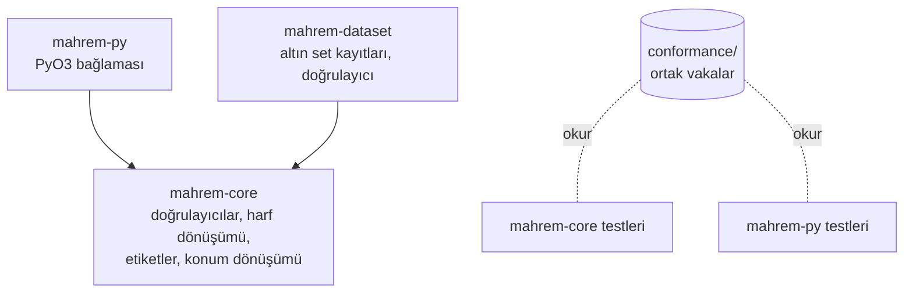

# Mimari

Bu belge crate sınırlarını ve bağımlılık yönünü anlatır. Ürünün ne yaptığı ve veri akışı (tespit → maske → vault → geri yerleştirme) [README.md](../README.md)'deki "How it works" bölümündedir; burada tekrar edilmez.

## Bugünkü durum

- Kod `mahrem-core`, `mahrem-py` ve `mahrem-dataset` içindedir. Diğer crate'ler yer tutucudur ve hiçbir bağımlılıkları yoktur.
- `mahrem-core`'un çalışma zamanı bağımlılığı yoktur. Etiket listesi (`Label`) burada durur, çünkü motorun çıktısı bu türlerle ifade edilir.
- `mahrem-py` yalnızca çekirdeği dışarı açar; kendi mantığı yoktur.
- `mahrem-dataset` motor değil, veri aracıdır: altın set ve tahmin dosyalarının kayıt tipleri ve doğrulayıcısı ([format](gold-set/README.md)). Bench, harness ve veri üretimi bunu kullanacak. Gerekçe: [0004](decisions/0004-veri-seti-crate.md).

## Değişmeyecek sınırlar

- **Tek motor.** Tespit, maskeleme ve geri yerleştirme mantığı `mahrem-core`'da yaşar. Python paketi, gateway ve benchmark bu mantığı yeniden yazmaz, çağırır.
- **Conformance bunu doğrular.** Aynı girdi her yüzeyde aynı çıktıyı vermelidir; vakalar `conformance/` altındadır.
- **`unsafe` yalnızca `mahrem-py`'de.** Workspace'in geri kalanında `unsafe_code = "forbid"`.

## Planlanan, henüz yazılmamış

Crate başlıklarında yazan niyetlerdir; kod gelince bu bölüm "Bugünkü durum"a taşınır.

- `mahrem-llm`'i hem `mahrem-gateway` hem `mahrem-harness` kullanacak.
- `mahrem-tools`'u ajanlar ve MCP sunucusu kullanacak.
- `mahrem-ner` modeli ONNX Runtime ile CPU'da çalıştıracak.
- `mahrem-vault` etiket ile gerçek değer eşlemesini şifreli saklayacak.

Bir crate ilk kez doldurulurken sınırı ve bağımlılıkları burada güncellenir; gerekçesi [decisions/](decisions/README.md) altına yazılır.
