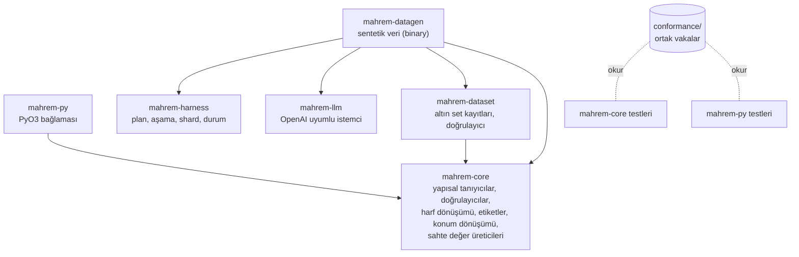

# Mimari

Bu belge crate sınırlarını ve bağımlılık yönünü anlatır. Ürünün ne yaptığı ve veri akışı (tespit → maske → vault → geri yerleştirme) [README.md](../README.md)'deki "How it works" bölümündedir; burada tekrar edilmez.

## Bugünkü durum

- Kod `mahrem-core`, `mahrem-py`, `mahrem-dataset`, `mahrem-harness`, `mahrem-llm` ve `mahrem-datagen` içindedir. Diğer crate'ler yer tutucudur ve hiçbir bağımlılıkları yoktur.
- `mahrem-core`'un çalışma zamanı bağımlılığı yoktur. Etiket listesi (`Label`) burada durur, çünkü motorun çıktısı bu türlerle ifade edilir.
- Yapısal tanıyıcılar (`mahrem_core::detect`, `analyze`) çekirdektedir; bağımlılıksız, elle yazılmış bir tarayıcıdır. Gerekçe: [0011](decisions/0011-yapisal-tarayici.md).
- Sahte değer üreticileri (`mahrem_core::fake`) de çekirdektedir: sentetik veri hattı ve ileride sahte veri operatörü aynı kodu kullanır. Gerekçe: [0010](decisions/0010-sahte-deger-ureticileri.md).
- `mahrem-py` yalnızca çekirdeği dışarı açar; kendi mantığı yoktur.
- `mahrem-dataset` motor değil, veri aracıdır: altın set ve tahmin dosyalarının kayıt tipleri, doğrulayıcısı, dağılım raporu, açık/kapalı bölmesi ve kapalı bölüm özeti ([format](gold-set/README.md), [kompozisyon](gold-set/composition.md)). Bench ve veri üretimi bunu kullanacak. Gerekçe: [0004](decisions/0004-veri-seti-crate.md).
- `mahrem-harness` toplu iş çalıştırıcıdır: deterministik plan, kaldığı yerden devam, köken kaydı. Hiçbir Mahrem crate'ine bağımlı değildir; LLM'i bilmez. Aşamayı yazan üst binary LLM'i çağırır. Gerekçe: [0008](decisions/0008-harness.md).
- `mahrem-llm` OpenAI uyumlu istemcidir: yeniden deneme, eşzamanlılık sınırı, token sayacı. Hiçbir Mahrem crate'ine bağımlı değildir. Varsayılan olarak yalnızca yerel uca bağlanır: [0009](decisions/0009-llm-yerel-uc.md).
- `mahrem-datagen` ilk üst binary'dir: harness'ın aşamasını yazar, LLM'i çağırır, değerleri çekirdeğin üreticileriyle yerleştirir, kayıtları `mahrem-dataset`'le doğrular ve böler. Kılavuz: [datagen.md](datagen.md).

## Değişmeyecek sınırlar

- **Tek motor.** Tespit, maskeleme ve geri yerleştirme mantığı `mahrem-core`'da yaşar. Python paketi, gateway ve benchmark bu mantığı yeniden yazmaz, çağırır.
- **Conformance bunu doğrular.** Aynı girdi her yüzeyde aynı çıktıyı vermelidir; vakalar `conformance/` altındadır.
- **`unsafe` yalnızca `mahrem-py`'de.** Workspace'in geri kalanında `unsafe_code = "forbid"`.

## Planlanan, henüz yazılmamış

Crate başlıklarında yazan niyetlerdir; kod gelince bu bölüm "Bugünkü durum"a taşınır.

- `mahrem-llm`'i ayrıca `mahrem-gateway` kullanacak.
- `mahrem-tools`'u ajanlar ve MCP sunucusu kullanacak.
- `mahrem-ner` modeli ONNX Runtime ile CPU'da çalıştıracak.
- `mahrem-vault` etiket ile gerçek değer eşlemesini şifreli saklayacak.

Bir crate ilk kez doldurulurken sınırı ve bağımlılıkları burada güncellenir; gerekçesi [decisions/](decisions/README.md) altına yazılır.
